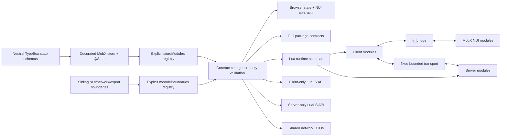

# Architecture v2

`lr_trucker_job` v2 là FiveM/GTA5 boilerplate standalone. Kiến trúc là
module-first ở nghiệp vụ nhưng side-first ở runtime: module có thể trải trên nhiều
side, còn client, server và shared không dùng chung global type workspace.

## Runtime boundaries

| Side | Namespace | Được phép thấy |
|---|---|---|
| Shared | `LRShared` | pure helpers, schema, lifecycle abstractions |
| Client | `LRClient : LRShared` | Cfx client natives, NUI, client net/public API, optional client framework bridge |
| Server | `LRServer : LRShared` | Cfx server natives, server net/public API, optional server framework bridge |
| NUI | TypeScript | decorated MobX stores, generated contract và typed NUI facade |

`fxmanifest.lua` quyết định load order; Lua runtime không dùng `require`. Shared
không gọi `IsDuplicityVersion()` để rẽ sang code client/server. Core không phụ thuộc
framework, database hoặc ox resource.

## Module lifecycle

Mỗi side đăng ký descriptor độc lập:

```lua
LR.Modules:Register({
    id = "inventory",
    dependencies = { "player" },
    start = "player",
    ---@param context LRClient.ModuleContext
    create = function(context)
        ---@class LRClient.ModuleMap
        ---@field inventory LRClient.InventoryModule
        ---@class LRClient.InventoryModule : LRClient.ModuleInstance
        local instance = {}
        ---@param readyContext LRClient.ModuleContext
        function instance:OnReady(readyContext) end
        ---@param startContext LRClient.ModuleContext
        function instance:Start(startContext) end
        ---@param stopContext LRClient.ModuleContext
        function instance:Stop(stopContext) end
        return instance
    end,
})
```

Registry validate ID, dependency và start phase, sau đó topological sort. Trong mỗi
phase, lifecycle cố định là `Create all -> OnReady all -> Start all -> Stop reverse`.
`OnReady` chuẩn bị dữ liệu/API riêng; khi vào `Start`, mọi module cùng phase đã sẵn
sàng nên có thể gọi nhau. Mỗi Application có instance mới. Player module chờ readiness
provider, resource module chạy trong boot. Stop và failure rollback dọn module theo
dependency order đảo ngược.

Module file tự đăng ký descriptor qua alias `LR.Modules`. Shared, client và server được
lưu trong `LR.SharedModules`, `LR.ClientModules`, `LR.ServerModules`; Application compose
shared part với side part cùng ID, start shared trước side và stop đảo ngược. Registry
sau đó được lọc theo `Config.Modules`. Vì vậy thêm module mới không cần sửa core hoặc
bootstrap, nhưng start phase lệch, dependency bị tắt/thiếu vẫn làm startup fail rõ ràng.

Context chứa logger, scheduler, disposable registry, services và transport đúng side.
Mọi registration/timer/subscription phải trả disposer và được gắn vào context.

Framework integration là boot-level service nằm ngoài core. Manifest load side core,
`client/bridges` hoặc `server/bridges`, generated contracts, modules rồi mới boot. Boot
chọn `standalone`, ESX, QBCore hoặc Qbox và inject cùng một normalized service name là
`framework`; selected client bridge cũng cung cấp readiness cho player-phase modules.
Adapter giữ raw exports/events trong exact boundary, chỉ trả plain player/job/gang DTO.
Không framework nào là hard manifest dependency.

## Contract flow



Generated client declarations chứa NUI, client net và client public accessor cụ thể.
Generated server declarations chỉ chứa server net/public accessor. Network DTO có thể
shared; export DTO được sinh riêng theo side. Generated file không có runtime logic và
không được chỉnh tay.

Canonical authoring source được tách theo trách nhiệm. TypeBox schemas và sibling
boundary definitions trung lập nằm trong
`packages/contracts/src/authoring/<module_id>/<module_id>.schemas.ts` và
`<module_id>.boundaries.ts`; decorated MobX store nằm trong
`web/src/app/modules/<module_id>/<module_id>.store.ts`, còn explicit `storeModules`
registry nằm tại `web/src/app/modules/registry.ts`. Boundary file export riêng NUI,
network và export boundary rồi ghép thành `<id>Boundaries`; explicit `moduleBoundaries`
registry trong `packages/contracts/src/authoring/index.ts` map module ID tới combined
constant. Ba boundary này là sibling và không thuộc decorated store.

Decorated store dùng `@Store({id: 'inventory'})` và chỉ import state schemas qua specific
public subpath như `@lr/contracts/authoring/inventory`. Mỗi
`packages/contracts/src/authoring/<module_id>/index.ts` chỉ export schemas. Boundary files,
direct schema-file paths và root authoring index không được package-export cho browser.
Codegen compose `@State` metadata từ `storeModules` với `moduleBoundaries` và validate
one-to-one parity.

Browser generated contracts chỉ chứa synchronized state và NUI. Network và exports vẫn
có trong full package contracts, Lua runtime schemas và LuaLS API đúng side, nhưng không
được import hoặc bundle bởi web stores. `packages/contracts/src/modules/` là generated
output, không phải nơi author viết contract. `@lr/nui-store` trích state metadata từ
store registry và tự tạo MobX observables khi application bind store.

LuaLS Cfx declarations cũng tách tuyệt đối theo `shared/client/server`. GTA5 và
CitizenFX metadata JSON được snapshot trong `tooling/cfx/snapshot`, khóa bằng URL,
source revision (ETag), Last-Modified, byte length và SHA-256 trong
`snapshot.lock.json`. Generator đưa
GTA5 natives vào client, rồi phân CFX natives theo `apiset`; entry dành cho `rdr3`/`ny`
bị loại. `pnpm generate:cfx` và `pnpm check:cfx` chỉ đọc snapshot committed, không truy
cập mạng. Chỉ `pnpm update:cfx` chủ động tải snapshot upstream mới.

Các public factory có annotation ngay trên runtime implementation và declaration theo
side. LuaLS fixtures load cả source thật lẫn type library, rồi dùng negative type probe
để đảm bảo kết quả factory là class cụ thể thay vì `unknown`.

## Synchronized state and composition

Synchronized state không có owner. Lua và NUI đều có thể đọc, thay toàn bộ giá trị và
shallow-patch object state. Lua bridge giữ canonical value và revision tăng đơn điệu cho
từng state; write hợp lệ được bridge chấp nhận sau cùng sẽ thắng. Mọi commit được
validate, deep-clone, chuyển thành full `state.snapshot`, rồi mới notify watchers.

Browser command `state.set`/`state.patch` mang `requestId` và `sessionId` nhưng không mang
revision. Browser áp optimistic value ngay và serialize command theo từng state. ACK hoặc
snapshot canonical từ Lua sẽ reconcile optimistic queue. Decorated store assignment dùng
cùng pipeline qua automatic MobX binding; invalid assignment throw `TypeError` đồng bộ,
còn transport failure được chuyển tới runtime `onError`. `AppRuntime.flush()` có thể chờ
các assignment đang pending khi caller cần một synchronization point.

NUI dùng explicit `storeModules` composition. Store không fetch hoặc postMessage trực
tiếp; binding gọi typed facade. Codegen và runtime đều bắt nguồn từ registry thay vì
hard-code một module ID. Runtime chỉ tạo một `window.message` listener và compile
validator một lần khi boot. Browser mock cũng dùng typed map `rpc[module][endpoint]` từ
cùng generated contract và đi qua canonical response validation.

Protocol v2 handshake dùng session riêng cho mỗi browser runtime. Browser gửi
`core/event/ready`, Lua ACK, phát full snapshot của mọi state, rồi phát
`core/event/synced`. `NuiRuntime.ready()` và `AppRuntime.start()` chỉ resolve sau barrier
`core.synced` đúng `sessionId`, nên UI không quan sát startup hoàn tất trước initial state.

## Failure model

- Invalid schema, unknown endpoint, oversized payload, stale session hoặc stale snapshot
  revision: reject trước handler.
- NUI chưa ready: Lua state snapshot coalesce, event drop, RPC fail `NUI_NOT_READY`.
- Browser state command thiếu `requestId`/`sessionId`, có revision hoặc reuse request ID
  với nội dung khác: reject; replay giống hệt nhận lại ACK đã lưu.
- RPC timeout/dispose: pending request bị cancel và late response bị bỏ.
- Client-to-server mutating RPC: không register nếu thiếu `Authorize`.
- Mutating public export: authorize theo `GetInvokingResource()` và fail closed.
- State DTO được deep-clone khi nhận/lưu/trả; caller không thể sửa canonical state qua
  table/object reference.
- Ingress, request/response và public export đều bounded; callback người dùng được cô
  lập để không làm ngắt cleanup transaction.
- Resource stop: app, transport, handler, timer và subscription được dispose.
